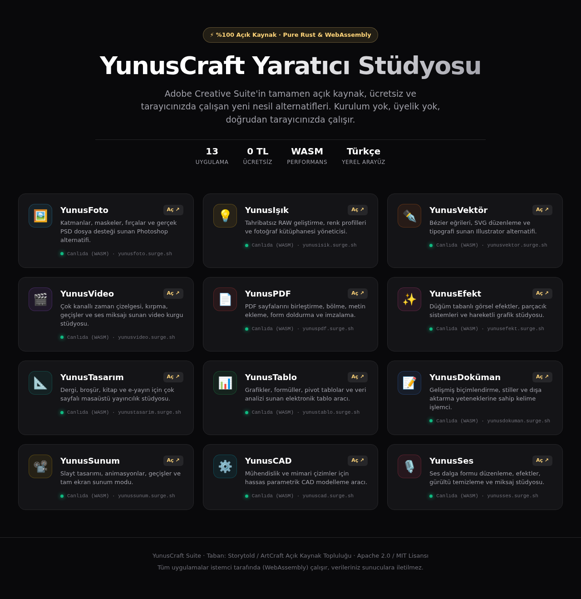
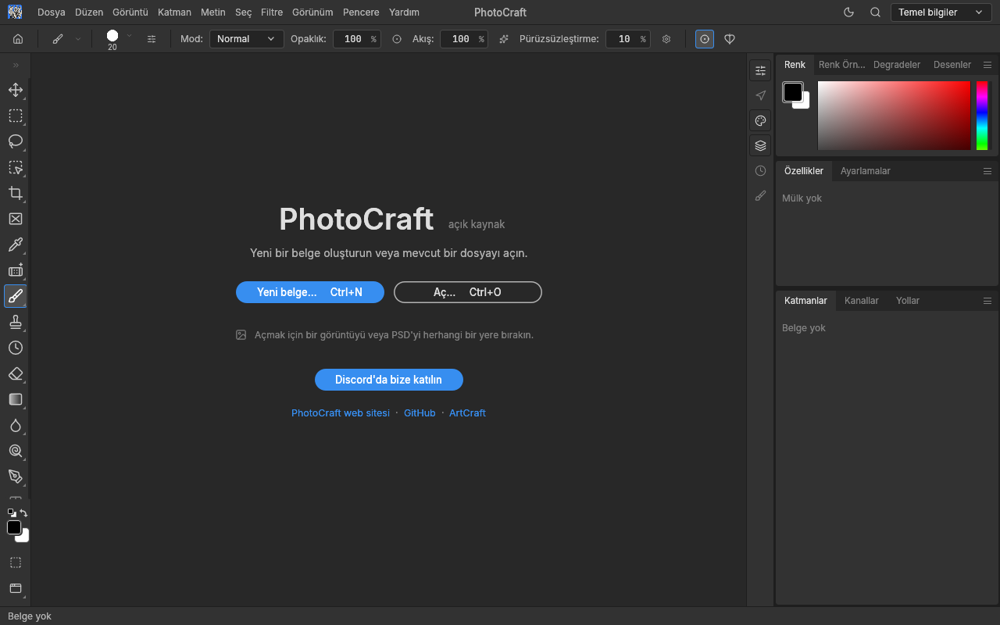

# 🎨 YunusCraft — Açık Kaynak Yaratıcı Web Stüdyosu



**YunusCraft**, Adobe Creative Suite araçlarının (Photoshop, Illustrator, Lightroom, Premiere, Acrobat, InDesign vb.) %100 açık kaynak kodlu, ücretsiz ve doğrudan web tarayıcınızda çalışan yeni nesil WebAssembly (WASM) alternatiflerini tek bir çatı altında toplayan profesyonel yaratıcı stüdyo paketidir.

---

## 🌟 Canlı Bağlantılar ve Uygulama Dizini

Tüm uygulamalar **Surge.sh** üzerinde canlıdadır. Herhangi bir kurulum, üyelik veya eklenti gerektirmeden doğrudan tarayıcınızda açılır:

| Uygulama | Eşdeğeri | Açıklama | Canlı Web Adresi |
|---|---|---|---|
| **YunusFoto** | Adobe Photoshop | Katmanlar, maskeler, fırçalar, gerçek PSD desteği | [yunusfoto.surge.sh](https://yunusfoto.surge.sh) |
| **YunusIşık** | Adobe Lightroom | Tahribatsız RAW geliştirme, renk profilleri | [yunusisik.surge.sh](https://yunusisik.surge.sh) |
| **YunusVektör** | Adobe Illustrator | Bézier eğrileri, SVG düzenleme, tipografi | [yunusvektor.surge.sh](https://yunusvektor.surge.sh) |
| **YunusVideo** | Adobe Premiere | Çok kanallı zaman çizelgesi, kurgu, geçişler | [yunusvideo.surge.sh](https://yunusvideo.surge.sh) |
| **YunusPDF** | Adobe Acrobat | PDF birleştirme, bölme, düzenleme, form doldurma | [yunuspdf.surge.sh](https://yunuspdf.surge.sh) |
| **YunusEfekt** | Adobe After Effects | Düğüm tabanlı görsel efektler, parçacık sistemleri | [yunusefekt.surge.sh](https://yunusefekt.surge.sh) |
| **YunusTasarım** | Adobe InDesign | Dergi, kitap, broşür için sayfa mizanpajı | [yunustasarim.surge.sh](https://yunustasarim.surge.sh) |
| **YunusTablo** | MS Excel / Sheets | Formüller, pivot tablolar ve veri analizi | [yunustablo.surge.sh](https://yunustablo.surge.sh) |
| **YunusDoküman** | MS Word / Docs | Biçimlendirme ve stiller sunan kelime işlemci | [yunusdokuman.surge.sh](https://yunusdokuman.surge.sh) |
| **YunusSunum** | MS PowerPoint | Slayt tasarımı, animasyonlar, tam ekran sunum | [yunussunum.surge.sh](https://yunussunum.surge.sh) |
| **YunusCAD** | AutoCAD / CAD | 2D/3D parametrik teknik çizim ve modelleme | [yunuscad.surge.sh](https://yunuscad.surge.sh) |
| **YunusSes** | Adobe Audition | Çok kanallı ses dalga formu ve miksaj stüdyosu | [yunusses.surge.sh](https://yunusses.surge.sh) |
| **YunusCraft Başlatıcı** | ArtCraft Hub | WebAssembly Canvas tabanlı yerel başlatıcı | [yunuscraft-baslatici.surge.sh](https://yunuscraft-baslatici.surge.sh) |
| **Ana Portal** | Creative Cloud Hub | Tüm araçlara tek noktadan erişim portalı | [yunuscraft.surge.sh](https://yunuscraft.surge.sh) |

---

## 📸 Ekran Görüntüsü: YunusFoto Türkçe Arayüz



---

## ⚡ Temel Özellikler

- **%100 İstemci Taraflı (WASM):** Tüm işlemler tarayıcınızın kendi donanım hızlandırması (WebGL2 / WebGPU) ile yapılır. Fotoğraflarınız ve dosyalarınız sunucuya gönderilmez, tamamen cihazınızda kalır.
- **Sıfır Kurulum:** Kurulum dosyası indirmeye gerek kalmadan herhangi bir modern tarayıcıda (Chrome, Edge, Firefox, Safari) çalışır.
- **Entegre Stüdyo Menüsü:** Her uygulamanın sağ alt köşesinde bulunan **"🎨 YunusCraft Stüdyo"** butonu sayesinde diğer tüm araçlara tek tıkla geçiş yapabilirsiniz.
- **Türkçe Desteği:** Türkçe menü, komut ve araç desteği.

---

## 🛠️ Yerel Çalıştırma

Tüm uygulamaları internet bağlantısı olmadan kendi bilgisayarınızda çalıştırmak için:

```bash
# Python ile yerel sunucu başlatın
python3 -m http.server 8080

# Tarayıcınızda açın:
# http://localhost:8080
```

---

## 📄 Lisans ve Teşekkür

Bu proje, açık kaynak topluluğunun geliştirdiği **Storytold / ArtCraft** ailesi üzerine inşa edilmiştir.  
Lisans: **Apache 2.0 / MIT**.
